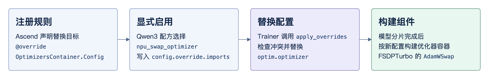

# FSDPTurbo 接入 TorchTitan-Ascend 方案

## 汇报摘要

本阶段已有八项接入任务，我负责其中三项。第三节按 Kimi K3/K3.1、DeepSeek V4/V4.1 和 Qwen3.8-Flash-Next 列出 19 项特性的支持状态与接入理由。先用同模型的 Turbo 配方判断迁移方向。Flash-Next 的大表分片是优先新增项，融合损失与通信错峰先用目标配方定位。

- **Swap Optimizer 已完成 A2 复测。** Qwen3 0.6B 两卡训练的稳态峰值显存减少 **2.219 GiB/卡**。绑核后，吞吐仍比 fused AdamW 低 **约 26%–28%**。下一步分别验证新版的部分状态常驻和反向阶段提前搬运。
- **Turbo Muon + Swap Optimizer 已明确验证顺序。** 确认 Turbo Muon 的目标版本后，在 Kimi K3 上分别验证 Muon 更新和 AdamW 状态卸载，再评估组合收益。
- **Swap Activation 已完成首版选型。** 采用本机内存卸载路径（ActStash + SwapCore）。先验证 Qwen3 单层的激活恢复和梯度，再开展两卡测试。

## 1. TorchTitan-Ascend 的 Override 接入机制

以 Qwen3 的 Swap Optimizer 适配为例。

Override 作用于本次训练的配置节点。模型分片、训练循环和更新时机仍由 TorchTitan 管理。[上游 Override 说明](https://github.com/pytorch/torchtitan/blob/45e33cd413b64cb37a7840cfd3c9765d3c639ae1/torchtitan/config/OVERRIDE.md) · [Swap Optimizer 接入 PR #321](https://gitcode.com/Ascend/torchtitan-ascend/pull/321)

## 2. 已排期任务的接入价值

**前三项由我负责，其余五项沿用团队现有分工。** 后五项的模型为建议验证对象。

FSDPTurbo 配置以 `8494fff` 为准。点号表示 YAML 层级，例如 `memory.swap_activation` 是 `memory` 下的 `swap_activation`。Ascend 入口以 `6c62806` 为准。表内 `config.xxx` 表示在 Python recipe（训练配置函数）里设置，`CONFIG=...` 表示启动时选择该函数。实验分支单独标注。 [Turbo 配置定义](https://gitcode.com/Ascend/FSDPTurbo/blob/8494fffb2c5d19aa882c4ba40ad84f94a0648ed0/fsdp_turbo/fsdp_turbo_config.py#L586) · [Ascend 启动示例](https://gitcode.com/Ascend/torchtitan-ascend/blob/6c628066864f0d190bb94a494d34c5c4de1f193c/docs/models/deepseek_v4_1.md#L26)

| 已排期任务 | FSDPTurbo 开关或配置 | TorchTitan-Ascend 配置或 recipe | 做什么、解决什么问题 | 基础技术 | 计划模型与具体问题 |
|---|---|---|---|---|---|
| **Swap Optimizer** | `optimizer.optimizer_type: AdamWSwap`。新版可用 `optimizer.resident_states_ratio` 调状态常驻比例，用 `optimizer.prefetch_states_at_backward` 指定反向阶段的预取触发模块。 | 实验分支 `d1aae61` 用 `CONFIG=qwen3_debugmodel_swap_optimizer_npu`。`6c62806` 主线快照未包含该入口。 [PR #321](https://gitcode.com/Ascend/torchtitan-ascend/pull/321) | AdamW 要保存两份关于梯度的历史统计。训练步之间存到主机内存，更新时分批搬回 NPU，以搬运时间换取显存。 | AdamW 动量状态、CPU 卸载 | **Qwen3 0.6B**。旧版在 A2 两卡上显存收益明确，但绑核后吞吐仍低于 fused AdamW。用同一模型验证新版能否减小差距。 |
| **Turbo Muon + Swap Optimizer** | 公开实现入口为 `MuonAdamW`，用 `use_muon=True` 标记参数组。目标 Muon 及与 AdamWSwap 的组合入口待确认。 [MuonAdamW 源码](https://gitcode.com/Ascend/FSDPTurbo/blob/8494fffb2c5d19aa882c4ba40ad84f94a0648ed0/fsdp_turbo/optimizer/muon.py#L56) | `kimi_k3_7b_npu` 已用 DistMuon + AdamW。Turbo Muon 与混合优化器内的 Swap 待接入。 [K3 7B 优化器配置](https://gitcode.com/Ascend/torchtitan-ascend/blob/6c628066864f0d190bb94a494d34c5c4de1f193c/torchtitan_ascend_recipes/models/kimi_k3.py#L194) | Kimi 的参数分别交给 Muon 和 AdamW。Muon 组验证新版能否加快参数更新，AdamW 组通过搬运状态减少显存占用。 | Muon 更新算法、混合优化器分组、AdamW 状态卸载 | **Kimi K3 Debug → Kimi K3 7B**。Kimi 混用 DistMuon 和 AdamW，现有 Qwen3 适配只支持单 AdamW，需要支持只卸载混合配方中的 AdamW 状态。 |
| **Swap Activation** | `memory.swap_activation: true`。首版参考 `memory.swap_activation_plan.impl: stash`、`memory.swap_backend: local`，用 `apply_modules` 指定卸载范围。 [本机卸载配置](https://gitcode.com/Ascend/FSDPTurbo/blob/8494fffb2c5d19aa882c4ba40ad84f94a0648ed0/docs/zh/features/swap_activation.md#L58) | ActStash 激活卸载待接入。 | 前向算出的部分中间结果要留到反向。先把它们放到主机内存，反向用到时再搬回 NPU，缩短它们占用显存的时间。 | 反向传播保存的张量、CPU 卸载 | **Qwen3 Debug → Kimi K3 7B 图文训练**。先验证 Qwen3 单层恢复和梯度，再确认 Kimi 语言塔和视觉塔各自保留了多少激活，以及卸载能否降低显存峰值。 |
| 权重加载性能优化 | V4.1 用 `model.load_pretrained_weights: true` 和 `model.model_name_or_path`，训练入口先分片，再加载 HF 权重。 [V4.1 加载入口](https://gitcode.com/Ascend/FSDPTurbo/blob/8494fffb2c5d19aa882c4ba40ad84f94a0648ed0/examples/deepseek_v41/train.py#L155) | 有模型权重适配器的 recipe 可用 `CheckpointManager.Config(initial_load_in_hf=True, initial_load_path=...)` 加载 HF 权重。V4.1 Debug 默认随机初始化，分片加载的性能优化待验证。 [HF 加载说明](https://github.com/pytorch/torchtitan/blob/45e33cd413b64cb37a7840cfd3c9765d3c639ae1/torchtitan/components/checkpointer/README.md#huggingface) | 每张卡直接从检查点读取自己负责的那块权重，减少读入整份权重再切分产生的重复读取和临时内存。 | DeviceMesh 设备分组、DCP 分布式检查点读取 | **DeepSeek V4.1**。现有 Ascend Debug 配方随机初始化，未覆盖预训练权重加载。用实际检查点验证分片读取的耗时和主机内存峰值。 |
| 上下文并行 | 按配方将 `distributed.ulysses_parallel_size` 或 `distributed.kv_allgather_parallel_size` 设为大于 `1`，模型相关选项在 `distributed.cp_plan`。 | K3 自定义 recipe 里设 `config.parallelism.context_parallel_degree` 大于 `1`、`context_parallel_load_balancer=None`，再调用 `kimi_k3_cp_transform` 选后端。V4.1 CP 待接入。 [K3 配方示例](https://gitcode.com/Ascend/torchtitan-ascend/blob/6c628066864f0d190bb94a494d34c5c4de1f193c/docs/models/kimi_k3.md#L181) | 把同一条长文本切成多段分给多张卡。计算注意力时，各卡交换所需的数据，让每张卡主要处理自己负责的一段。 | 注意力计算、按序列维度切分、卡间通信 | **DeepSeek V4.1 Debug**。现有 packed 文本配方尚未支持上下文并行。先验证打包序列切分后的 KV 交换、词位置、文档边界和注意力掩码。 |
| OpReplay 选择性重计算 | `memory.recompute: true`，用 `memory.recompute_plan` 选要重算的模块，用 `memory.op_replay_scopes` 选要保留输出的算子和模块。 | `kimi_k3_1_reduced_npu` 已设置 `config.activation_remat = DefaultActivationRematConfig()`。OpReplay 待接入。 [K3.1 配方](https://gitcode.com/Ascend/torchtitan-ascend/blob/6c628066864f0d190bb94a494d34c5c4de1f193c/torchtitan_ascend_recipes/models/kimi_k3_1.py#L215) | 反向需要重算一个模型块时，可以复用前向保留的高耗时算子结果，其余算子重新计算，在显存和计算时间之间取平衡。 | 激活重计算、算子输出缓存与重放 | **Kimi K3 Debug 图文配方**。Turbo 示例已为语言层和视觉层配置重放范围。要确认哪些结果值得保留，哪些可以重算，以及对训练速度的影响。 |
| Engram 优化 | V4.1 用 `model.engram_storage_backend` 选后端。A3 示例为 `host_offload`，A5 示例为 `elastic_buffer`。 [A3 配置](https://gitcode.com/Ascend/FSDPTurbo/blob/8494fffb2c5d19aa882c4ba40ad84f94a0648ed0/examples/deepseek_v41/config_A3.yaml#L14) · [A5 配置](https://gitcode.com/Ascend/FSDPTurbo/blob/8494fffb2c5d19aa882c4ba40ad84f94a0648ed0/examples/deepseek_v41/config_A5.yaml#L15) | V4.1 Debug 配方的 Engram 路径待接入。 [支持范围](https://gitcode.com/Ascend/torchtitan-ascend/blob/6c628066864f0d190bb94a494d34c5c4de1f193c/docs/models/deepseek_v4_1.md#L46) | 根据最近几个 token 在一张大表里查信息。表和更新状态很大时，把它分到多张卡或放到主机内存，减轻显存压力。 | Embedding 查表、权重按行分片、主机卸载 | **DeepSeek V4.1 Engram**。现有 Ascend 配方未提供 Engram 路径。需验证大表分片、主机卸载和训练更新。 |
| Swap Core CPU 卸载 | ActStash 和 OpReplay 使用 `memory.swap_plan` 配置共享缓存。FSDP 参数和梯度卸载用 `distributed.fsdp_plan.cpu_offload: true`，优化器状态另选 AdamWSwap。 [共享缓存入口](https://gitcode.com/Ascend/FSDPTurbo/blob/8494fffb2c5d19aa882c4ba40ad84f94a0648ed0/fsdp_turbo/fsdp_turbo.py#L255) | FSDP 的 CPU 卸载在 recipe 设 `config.training.enable_cpu_offload = True`。Swap Core 共享路径待接入。 [FSDP2 文档](https://github.com/pytorch/torchtitan/blob/45e33cd413b64cb37a7840cfd3c9765d3c639ae1/torchtitan/distributed/FSDP.md) | 将内存分配、数据搬运、完成确认和释放做成共用组件，供参数、梯度、优化器状态和激活卸载使用。 | CPU 卸载、锁页内存、异步拷贝与事件同步 | **Qwen3 Debug**。各类张量的使用时机不同。验证在搬运完成后才读取、最后一次使用后才释放，并覆盖梯度累积。 |

**协作边界。** Kimi 的混合优化器复用 Qwen3 的 AdamW 状态卸载适配。Swap Activation、Swap Core 和 OpReplay 共同约定激活的保存、恢复与释放时机。[Kimi K3 配方](https://gitcode.com/Ascend/torchtitan-ascend/blob/6c628066864f0d190bb94a494d34c5c4de1f193c/docs/models/kimi_k3.md) · [DeepSeek V4.1 支持范围](https://gitcode.com/Ascend/torchtitan-ascend/blob/6c628066864f0d190bb94a494d34c5c4de1f193c/docs/models/deepseek_v4_1.md#支持范围) · [Turbo Kimi K3 示例](https://gitcode.com/Ascend/FSDPTurbo/blob/4b0f0706e495a58a43f128030310caf5d494942f/examples/kimi_k3/config.yaml#L204)

## 3. FSDPTurbo 特性支持与重点模型接入理由

核对基线为 FSDPTurbo `8494fff`、TorchTitan v0.4.0 `45e33cd` 和 TorchTitan-Ascend 主线 `6c62806`。**已有**表示有实现或配方，**部分已有**表示只有基础能力或覆盖部分模型，**未见**表示本次核对的主线未找到相应实现。表中的 Qwen4 指公开的 Qwen3.8-Flash-Next 预览架构 `qwen4_exp`。Ascend 当前主线的 Qwen3.8 文档提供文本 Debug 配方，Flash-Next 的 PLE 路径需单独验收。[Ascend 安装基线](https://gitcode.com/Ascend/torchtitan-ascend/blob/6c628066864f0d190bb94a494d34c5c4de1f193c/INSTALL.md) · [Ascend Qwen3.8 配方](https://gitcode.com/Ascend/torchtitan-ascend/blob/6c628066864f0d190bb94a494d34c5c4de1f193c/docs/models/qwen3_8.md) · [Flash-Next 官方配置](https://huggingface.co/Qwen/Qwen3.8-Flash-Next/blob/main/config.json)

### 先对照同一模型的训练配方

先看 `run.sh` 实际选哪个 YAML，再核对训练入口是否消费那个开关。**默认启用**指默认 YAML 已选择且代码已接通。**可选**指入口有对应路径，需要额外配置。两者的性能都要用 Ascend 的目标配方复测。

| 模型 | FSDPTurbo 配方与实际选择 | TorchTitan-Ascend 对应配方 | 可以迁移或复用的做法 |
|---|---|---|---|
| **Kimi K3** | 默认 `config.yaml` 用本机 **AdamWSwap**、Ulysses=2 和前后向各预取 1 个单元。默认关闭分块 loss、重计算和激活交换。1M 图文说明另外推荐 `mm_merge_chunk_tokens=65536`，用来避免合并图文时复制整段文本嵌入。[启动脚本](https://gitcode.com/Ascend/FSDPTurbo/blob/8494fffb2c5d19aa882c4ba40ad84f94a0648ed0/examples/kimi_k3/run.sh#L33) · [默认配置](https://gitcode.com/Ascend/FSDPTurbo/blob/8494fffb2c5d19aa882c4ba40ad84f94a0648ed0/examples/kimi_k3/config.yaml#L20) · [优化器构建](https://gitcode.com/Ascend/FSDPTurbo/blob/8494fffb2c5d19aa882c4ba40ad84f94a0648ed0/fsdp_turbo/training/trainer.py#L518) · [1M 配方说明](https://gitcode.com/Ascend/FSDPTurbo/blob/8494fffb2c5d19aa882c4ba40ad84f94a0648ed0/examples/kimi_k3/README.md#L219) | `kimi_k3_debugmodel_npu` / `kimi_k3_7b_npu` 已有 DistMuon + AdamW、打包和分块 loss，CP 可在配方中选择。 | **用 Turbo 默认配方指导已有 Swap Optimizer 任务**。在 Ascend 上只替换 AdamW 组，保留 DistMuon。若性能分析命中图文合并的显存峰值，可单独评估按 token 分块合并。 |
| **Kimi K3.1** | Turbo 主线可找到 K3.1 模型实现，`examples/` 未找到独立 K3.1 训练入口。K3 的 `train.py` 明确构建 K3 模型。[Turbo K3 训练入口](https://gitcode.com/Ascend/FSDPTurbo/blob/8494fffb2c5d19aa882c4ba40ad84f94a0648ed0/examples/kimi_k3/train.py#L40) · [Turbo K3.1 模型代码](https://gitcode.com/Ascend/FSDPTurbo/tree/8494fffb2c5d19aa882c4ba40ad84f94a0648ed0/fsdp_turbo/models/kimi/kimi_k31) | 有 `kimi_k3_1_reduced_npu` 和 `kimi_k3_1_pro_npu`，均有分块 loss 和图文 packing。Reduced 混用优化器，Pro 用单 AdamW。[Ascend K3.1 配方](https://gitcode.com/Ascend/torchtitan-ascend/blob/6c628066864f0d190bb94a494d34c5c4de1f193c/torchtitan_ascend_recipes/models/kimi_k3_1.py#L97) | **以 Ascend 配方为基线**。Reduced 验证混合优化器接线，Pro 验证单 AdamW 状态卸载。K3 的配置提供移植参考，K3.1 的收益单独测。 |
| **DeepSeek V4** | `run.sh` 默认读 `config_train.yaml`，选原生 FSDP2、EP=4、前后向预取深度各 2，开启重计算，AdamW，关闭 Swap Activation。备用 `config.yaml` 设 Ulysses=2。[启动脚本](https://gitcode.com/Ascend/FSDPTurbo/blob/8494fffb2c5d19aa882c4ba40ad84f94a0648ed0/examples/deepseekv4/run.sh#L77) · [默认配置](https://gitcode.com/Ascend/FSDPTurbo/blob/8494fffb2c5d19aa882c4ba40ad84f94a0648ed0/examples/deepseekv4/config_train.yaml#L87) · [备用配置](https://gitcode.com/Ascend/FSDPTurbo/blob/8494fffb2c5d19aa882c4ba40ad84f94a0648ed0/examples/deepseekv4/config.yaml) | `deepseek_v4_debugmodel_npu` 已有原生 FSDP2、分块 loss 和 AdamW。大规模配方的 token 负载需要另设。[Ascend V4 配方](https://gitcode.com/Ascend/torchtitan-ascend/blob/6c628066864f0d190bb94a494d34c5c4de1f193c/torchtitan_ascend_recipes/models/deepseek_v4.py#L46) | 复用**同模型的原生分片与预取配置**做对照，按现有模型模块确定包裹边界。Turbo 的预取深度 2 可以作为实验档位。长序列 CP 归已有任务。 |
| **DeepSeek V4.1** | 默认 A5 配方用 custom FSDP 的 1 层前后向预取，并指定 embedding → 视觉塔 → 对齐器 → 语言层 → 输出层的顺序。**A3 配方**选主机 Engram。**256 卡 A3 配方**开启普通分块 loss，块大小 1,024。训练入口另接通 **分片后加载 HF 权重**，需显式打开 `load_pretrained_weights`，稠密和专家权重走 DCP。[A5 配方](https://gitcode.com/Ascend/FSDPTurbo/blob/8494fffb2c5d19aa882c4ba40ad84f94a0648ed0/examples/deepseek_v41/config_A5.yaml#L147) · [A3 Engram 配方](https://gitcode.com/Ascend/FSDPTurbo/blob/8494fffb2c5d19aa882c4ba40ad84f94a0648ed0/examples/deepseek_v41/config_A3.yaml#L14) · [256 卡配置](https://gitcode.com/Ascend/FSDPTurbo/blob/8494fffb2c5d19aa882c4ba40ad84f94a0648ed0/examples/deepseek_v41/config_A3_16n256die.yaml#L184) · [权重加载入口](https://gitcode.com/Ascend/FSDPTurbo/blob/8494fffb2c5d19aa882c4ba40ad84f94a0648ed0/examples/deepseek_v41/train.py#L155) · [DCP 实现](https://gitcode.com/Ascend/FSDPTurbo/blob/8494fffb2c5d19aa882c4ba40ad84f94a0648ed0/fsdp_turbo/models/deepseek/deepseek_v41/state_dict_adapter.py#L394) | 已有原生和 HyperParallel Debug 配方。当前以文本随机初始化为基线，已有分块 loss 和 mHC AscendC。HyperParallel 有按本模型反向顺序设计的预取。[Ascend V4.1 配方](https://gitcode.com/Ascend/torchtitan-ascend/blob/6c628066864f0d190bb94a494d34c5c4de1f193c/docs/models/deepseek_v4_1.md) · [现有预取](https://gitcode.com/Ascend/torchtitan-ascend/blob/6c628066864f0d190bb94a494d34c5c4de1f193c/torchtitan_ascend/models/deepseek_v4_1/hp_fsdp.py#L42) | **Engram 和分片后直接加载权重有具体参考实现，交给已有两项任务**。有图文配方后，再参考视觉塔的包裹粒度和预取顺序。 |
| **Qwen3.8-Flash-Next / Qwen4 预览** | 默认 `config.yaml`，32K 图文、Ulysses=2。**PLE 设 VP=8**，训练入口在 FSDP 前物化可训练大表并按行分片。**开启重计算及 Swap Activation**，激活交换作用于语言层和 MTP 层，默认实现是 legacy。分块 loss 和 Batch Chunking 均关闭。[启动脚本](https://gitcode.com/Ascend/FSDPTurbo/blob/8494fffb2c5d19aa882c4ba40ad84f94a0648ed0/examples/qwen3_8/run.sh#L34) · [VP 配置](https://gitcode.com/Ascend/FSDPTurbo/blob/8494fffb2c5d19aa882c4ba40ad84f94a0648ed0/examples/qwen3_8/config.yaml#L83) · [VP 训练接线](https://gitcode.com/Ascend/FSDPTurbo/blob/8494fffb2c5d19aa882c4ba40ad84f94a0648ed0/examples/qwen3_8/train.py#L201) · [显存配置](https://gitcode.com/Ascend/FSDPTurbo/blob/8494fffb2c5d19aa882c4ba40ad84f94a0648ed0/examples/qwen3_8/config.yaml#L189) · [激活交换实现选择](https://gitcode.com/Ascend/FSDPTurbo/blob/8494fffb2c5d19aa882c4ba40ad84f94a0648ed0/fsdp_turbo/fsdp_turbo.py#L306) | 当前公开主线有 Qwen3.8 文本 Debug 配方，已用分块 loss 和 GDN。尚未见完整 Flash-Next PLE 接线。[Ascend Qwen3.8 配方](https://gitcode.com/Ascend/torchtitan-ascend/blob/6c628066864f0d190bb94a494d34c5c4de1f193c/docs/models/qwen3_8.md) | **优先接 PLE 的按行分片、跨卡查表和可训练更新**。激活交换复用团队的 Swap Activation 接口，参考 Turbo 选择卸载层。验收时同时核对 VP 组和数据副本组的维度、梯度归一化、DCP 保存与恢复。 |

**这会改变候选排序。** Flash-Next 的 VP 是首选新增迁移项。K3 的 AdamWSwap、V4.1 的 Engram/DCP 加载和 Flash-Next 的激活卸载可直接为已有任务提供参考。重点模型示例中的基础预取已经开启，`prefetch_wait_a2a`、`backward_prefetch_on_moe_input` 未启用。融合 CCE 可在源码中找到，训练入口调用未见。CCE、通信错峰与 Batch Chunking 继续按实际瓶颈决定是否开工。

### 与优先级直接相关的模型规模

| 目标模型 | 输出词表 | 选型依据 |
|---|---:|---|
| **Kimi K3 / K3.1** | **163,840** | K3 正式模型及 K3.1 Reduced/Pro 都是大词表，适合检查输出层峰值。K3 7B 裁剪配方只有 **2,048** 项，更适合先测通信。K3.1 Reduced 默认 16,384 token，每个 token 选 16 个专家，且有 27 层视觉编码器。[K3 官方配置](https://huggingface.co/moonshotai/Kimi-K3/blob/main/config.json) · [K3 7B 配方](https://gitcode.com/Ascend/torchtitan-ascend/blob/6c628066864f0d190bb94a494d34c5c4de1f193c/torchtitan_ascend_recipes/models/kimi_k3.py#L147) · [K3.1 配方](https://gitcode.com/Ascend/torchtitan-ascend/blob/6c628066864f0d190bb94a494d34c5c4de1f193c/docs/models/kimi_k3_1.md) |
| **DeepSeek V4 / V4.1** | **129,280** | 两个 Flash 规格均为 129,280 项。V4 Debug 裁到 **2,048**，V4.1 Debug 保留 **129,280**，因此用 V4.1 Debug 验证损失显存更有代表性。V4.1 Flash 的 Engram 配置有两张约 **3.84 亿行**的表，归已有 Engram 任务。[V4 Flash](https://huggingface.co/deepseek-ai/DeepSeek-V4-Flash/blob/main/inference/config.json) · [V4 Debug](https://github.com/pytorch/torchtitan/blob/45e33cd413b64cb37a7840cfd3c9765d3c639ae1/torchtitan/models/deepseek_v4/flavors.py#L724) · [V4.1 Flash](https://huggingface.co/deepseek-ai/DeepSeek-V4.1-Flash/blob/main/inference/config.json) · [V4.1 Debug](https://gitcode.com/Ascend/torchtitan-ascend/blob/6c628066864f0d190bb94a494d34c5c4de1f193c/torchtitan_ascend/models/deepseek_v4_1/flavors.py#L455) |
| **Qwen3.8-Flash-Next / Qwen4 预览** | **248,320** | 48 层、512 个专家，每个 token 选 10 个。另有约 **510 亿参数**的 PLE 查找表，按每参数 2 字节估算，表权重约 **95 GiB**。输出词表决定损失计算的大小，PLE 表的体积决定查表如何分片。[官方配置](https://huggingface.co/Qwen/Qwen3.8-Flash-Next/blob/main/config.json) · [Turbo Flash-Next 训练示例](https://gitcode.com/Ascend/FSDPTurbo/blob/8494fffb2c5d19aa882c4ba40ad84f94a0648ed0/examples/qwen3_8/config.yaml#L1) |

**CCE 的选型依据。** Turbo 文档将「词表超过 10 万」或「序列超过 32K」列为适合做分块损失优化的场景。用它筛选 CCE 对象，最终看调优后的分块 loss 是否仍是显存瓶颈。以每块 1,024 token、每个分数占 2 字节估算，一份中间分数在 K3.1、V4.1、Flash-Next 上分别约为 **320、252.5、485 MiB**。这些数字只估算一份中间张量，实测还要看计算精度和当时同时存活的张量。[Turbo Chunk Loss 适用场景](https://gitcode.com/Ascend/FSDPTurbo/blob/8494fffb2c5d19aa882c4ba40ad84f94a0648ed0/docs/zh/features/chunk_loss.md#适用场景) · [CCE 实现](https://gitcode.com/Ascend/FSDPTurbo/blob/8494fffb2c5d19aa882c4ba40ad84f94a0648ed0/fsdp_turbo/memory/chunk_loss/chunkloss_cce_fused.py)

### 19 项能力对照与接入建议

| FSDPTurbo 特性 | 文档链接 | FSDPTurbo 开关或配置 | TorchTitan-Ascend 配置或 recipe | TorchTitan v0.4.0 状态 | TorchTitan-Ascend 状态 | 接入原因与目标模型做法 | 建议 |
|---|---|---|---|---|---|---|---|
| **Vocabulary Parallelism（VP / V-FSDP）** | [VP](https://gitcode.com/Ascend/FSDPTurbo/blob/8494fffb2c5d19aa882c4ba40ad84f94a0648ed0/docs/zh/features/vocab_parallel.md) | `distributed.vocab_parallel_size: 8`（Flash-Next 示例）。`distributed.vp_plan.apply_modules` 指定查找表。二级分片用 `vocab_fully_shard_parallel_size` 和 `vp_plan.apply_vfsdp_modules`。 | 支持 TP 的配方将 `config.parallelism.tensor_parallel_degree` 设为大于 `1`，普通词嵌入随 TP 分片。Flash-Next 独立 VP 待接入。 [上游 Embedding](https://github.com/pytorch/torchtitan/blob/45e33cd413b64cb37a7840cfd3c9765d3c639ae1/torchtitan/models/common/embedding.py#L37) | **部分已有**，普通 TP 可分片 embedding | **部分已有**，未见独立 PLE VP | **Flash-Next** 的约 95 GiB PLE 表几乎占满一张 96 GiB 卡。若目标是训练这张表，先用缩小表验证按行分片、跨卡查表和梯度更新，再用 VP=8 验收全表。此时权重约 **11.9 GiB/卡**，梯度和优化器状态另计。 | **优先迁移验证** |
| **Chunk Loss / CCE** | [Chunk Loss](https://gitcode.com/Ascend/FSDPTurbo/blob/8494fffb2c5d19aa882c4ba40ad84f94a0648ed0/docs/zh/features/chunk_loss.md) · [CCE 源码](https://gitcode.com/Ascend/FSDPTurbo/blob/8494fffb2c5d19aa882c4ba40ad84f94a0648ed0/fsdp_turbo/memory/chunk_loss/chunkloss_cce_fused.py) | 分块 Loss 用 `memory.chunk_loss: true`，块大小用 `memory.chunk_loss_size`。融合 CCE 的代码入口是 `chunk_loss_cce_fused()`，本版配方未提供开关。 | `deepseek_v4_1_debugmodel_npu`、`kimi_k3_1_reduced_npu` 和 `qwen38_debugmodel_npu` 等配方已用 `ChunkedLossWrapper.Config`，用 `config.loss.num_chunks` 调分块数。融合 CCE 待评估。 [V4.1 loss 配置](https://gitcode.com/Ascend/torchtitan-ascend/blob/6c628066864f0d190bb94a494d34c5c4de1f193c/torchtitan_ascend_recipes/models/deepseek_v4_1.py#L84) | **部分已有**，有分块 loss，未见同类融合 CCE 配方 | **部分已有**，Kimi、DeepSeek 已有分块 loss，融合 CCE 待验证 | **K3.1 Reduced、DeepSeek V4.1 Debug** 先测打分与交叉熵的峰值，再决定是否融合。随后验证 **Flash-Next** 的 248,320 项词表。开启 MTP 或词表张量并行时，分别核对额外损失和分片梯度。 | **先定位输出层瓶颈** |
| **FSDP2 / Communication Prefetch** | [FSDP2 与预取](https://gitcode.com/Ascend/FSDPTurbo/blob/8494fffb2c5d19aa882c4ba40ad84f94a0648ed0/docs/zh/features/fully_shard_parallel.md#通信预取) | `distributed.fsdp_plan` 下用 `num_to_forward_prefetch` 和 `num_to_backward_prefetch` 设层数。`prefetch_wait_a2a` 调整前向预取时机，`backward_prefetch_on_moe_input` 调整反向预取时机，两项默认关闭。 | 原生 FSDP2 用 `config.parallelism.data_parallel_shard_degree` 配分片度，基础预取由 FSDP2 安排。V4.1 选 `CONFIG=deepseek_v4_1_debugmodel_hyper_npu` 启用 HyperParallel 预取，该路径要求 EP=1。 [V4.1 配方与依赖](https://gitcode.com/Ascend/torchtitan-ascend/blob/6c628066864f0d190bb94a494d34c5c4de1f193c/docs/models/deepseek_v4_1.md#L7) | **部分已有**，FSDP2、基础预取、CPU 卸载接口 | **部分已有**，有原生 FSDP2 和 V4.1 HyperParallel 预取，Turbo 通信错峰未见 | **K3 7B 原生 FSDP2 + 常规 EP** 先查权重聚合和专家 token 交换是否相互等待。确认后再改时机，复测 **K3.1 Reduced 或 V4/V4.1**。参数、梯度卸载由已有 Swap Core 推进。 | **先采集现有预取时间线** |
| **Expert Parallelism / EP Balance** | [EP 与负载均衡](https://gitcode.com/Ascend/FSDPTurbo/blob/8494fffb2c5d19aa882c4ba40ad84f94a0648ed0/docs/zh/features/expert_parallel.md) | `distributed.expert_parallel_size` 设并行度。`distributed.ep_plan.enable_ep_balance: true` 开启动态专家副本，需要 `dispatcher: all2all` 或 `allgather`。 | `config.parallelism.expert_parallel_degree` 大于 `1` 启用 EP。K3 可另选 `CONFIG=kimi_k3_7b_moonep`，或用 `--override` 选融合 dispatcher 或 MC2。Turbo EP Balance 待评估。 [K3 EP 用法](https://gitcode.com/Ascend/torchtitan-ascend/blob/6c628066864f0d190bb94a494d34c5c4de1f193c/docs/models/kimi_k3.md#L216) | **部分已有**，EP 与专家权重分片 | **部分已有**，有常规 EP、MC2、MoonEP，未见 Turbo `enable_ep_balance` | **K3.1 Reduced** 有 64 个专家、每 token 选 16 个，**V4.1 Flash** 有 384 个、选 6 个。先测常规 All-to-All 下各卡 token 数及耗时，持续存在热点再试专家副本。MoonEP 单独作现有基线。 | **热点确认后验证** |
| **Tensor Parallelism（TP / SP）** | [TP / SP](https://gitcode.com/Ascend/FSDPTurbo/blob/8494fffb2c5d19aa882c4ba40ad84f94a0648ed0/docs/zh/features/tensor_parallel.md) | `distributed.tensor_parallel_size` 设并行度，`distributed.tp_plan.sequence_parallel` 指定启用 SP 的模块。 | 用 `config.parallelism.tensor_parallel_degree` 和 `enable_sequence_parallel`。例如在 Python recipe 调用 `deepseek_v4_1_debugmodel_npu(tp=2, ep=2)`，会同时开启 SP。 [V4.1 并行配置](https://gitcode.com/Ascend/torchtitan-ascend/blob/6c628066864f0d190bb94a494d34c5c4de1f193c/docs/models/deepseek_v4_1.md#L40) | **已有** | **已有**，按模型配方覆盖 | **K3.1** 已有稀疏注意力（DSA）的 TP，**V4.1 Debug** 已运行 TP=2、EP=2。复用该切分方式，并对新增 CCE 的词表切分或 Flash-Next 的 QSA 层单独验证。 | **复用现有能力** |
| **Context Parallelism（CP）** | [CP](https://gitcode.com/Ascend/FSDPTurbo/blob/8494fffb2c5d19aa882c4ba40ad84f94a0648ed0/docs/zh/features/context_parallel.md) | `distributed.ulysses_parallel_size`、`distributed.kv_allgather_parallel_size` 或 `distributed.kcp_parallel_size` 设相应并行度，按模型填写 `distributed.cp_plan`。 | K3 自定义 recipe 里设 `config.parallelism.context_parallel_degree` 大于 `1`、`context_parallel_load_balancer=None`，再调用 `kimi_k3_cp_transform` 选后端。V4.1 CP 待接入。 [K3 配方示例](https://gitcode.com/Ascend/torchtitan-ascend/blob/6c628066864f0d190bb94a494d34c5c4de1f193c/docs/models/kimi_k3.md#L181) | **已有** Ulysses、KV All-Gather | **部分已有**，K3 有 MLA/KDA 路径，V4.1 packed 文本 CP 待接 | **DeepSeek V4/V4.1** 先验证压缩注意力切到多卡后，文档边界及 KV 交换是否正确。**Flash-Next** 随后验证 QSA 只交换被选中的 KV，以及 PLE 查表跨卡时所需的前序 token。Turbo 以 **32K+** 作为典型长序列场景，先从 CP=2 对照。 | **沿用已有 CP 任务** |
| **Batch Chunking** | [Batch Chunking](https://gitcode.com/Ascend/FSDPTurbo/blob/8494fffb2c5d19aa882c4ba40ad84f94a0648ed0/docs/zh/features/chunk_batch.md) | `memory.chunk_batch: true`。`memory.chunk_batch_plan.apply_modules` 选模块，`chunk_mbs` 设每块样本数。 | 训练级微批用 `config.training.num_tokens_per_microbatch_per_dp_rank`。指定模块内部切批待评估。 [训练配置](https://github.com/pytorch/torchtitan/blob/45e33cd413b64cb37a7840cfd3c9765d3c639ae1/torchtitan/config/configs.py#L37) | **部分已有**，训练微批和梯度累积 | **未见**同类模块内切分 | **K3/K3.1 图文**有独立视觉塔，K3.1 为 27 层。增加每批图片数，确认峰值是否在视觉塔单次前向，再与减小训练微批对照。现行 Turbo 实现要求首轮 CP=1。 | **显存瓶颈确认后验证** |
| **Activation Recompute / OpReplay** | [Recompute / OpReplay](https://gitcode.com/Ascend/FSDPTurbo/blob/8494fffb2c5d19aa882c4ba40ad84f94a0648ed0/docs/zh/features/recompute.md) | `memory.recompute: true`，用 `memory.recompute_plan` 指定重算模块。`memory.op_replay_scopes` 的 `apply_modules` 和 `cache_ops` 指定重放模块与算子。 | `kimi_k3_1_reduced_npu` 已设置 `config.activation_remat = DefaultActivationRematConfig()`。OpReplay 待接入。 [K3.1 配方](https://gitcode.com/Ascend/torchtitan-ascend/blob/6c628066864f0d190bb94a494d34c5c4de1f193c/torchtitan_ascend_recipes/models/kimi_k3_1.py#L215) | **已有**普通和选择性重计算 | **部分已有**，OpReplay 同款路径已排期 | **K3/K3.1 图文**的语言塔和视觉塔分别选耗时算子，缓存输出并在反向重算时取回。按省下的重算时间、额外缓存占用选算子，与 Swap Activation 对齐保存范围。 | **沿用已有 OpReplay 任务** |
| **Swap Activation** | [Swap Activation](https://gitcode.com/Ascend/FSDPTurbo/blob/8494fffb2c5d19aa882c4ba40ad84f94a0648ed0/docs/zh/features/swap_activation.md) | `memory.swap_activation: true`，在 `memory.swap_activation_plan.apply_modules` 选模块。`impl` 选 `legacy` 或 `stash`，`stash` 使用本机内存。 | ActStash 激活卸载待接入。 | **部分已有**，保存张量钩子 | **接入已排期**，主线未见 ActStash | **K3.1 Reduced** 可用 16K 图文负载测激活占用，先单层验证，再测两卡，记录减少多少峰值显存、增加多少搬运时间。底层复用 Swap Core。 | **沿用已有 Swap Activation 任务** |
| **Swap Optimizer（AdamWSwap）** | [Swap Optimizer](https://gitcode.com/Ascend/FSDPTurbo/blob/8494fffb2c5d19aa882c4ba40ad84f94a0648ed0/docs/zh/features/swap_optimizer.md) | `optimizer.optimizer_type: AdamWSwap`。可配置 `optimizer.mem_fraction_static`、`optimizer.resident_states_ratio` 和 `optimizer.prefetch_states_at_backward`。 | 实验分支 `d1aae61` 用 `CONFIG=qwen3_debugmodel_swap_optimizer_npu`。`6c62806` 主线快照未包含该入口。 [PR #321](https://gitcode.com/Ascend/torchtitan-ascend/pull/321) | **未见** AdamWSwap | **有 PR 与窄范围实测**，主线未见 | **K3.1 Pro、V4.1** 的单 AdamW 配方适合测状态搬运；**K3/K3.1 Reduced** 混用 Muon 和 AdamW，只替换 AdamW 组。用半驻留和反向预取分别对照，目标为保留显存收益并降低搬运开销。 | **沿用两项优化器任务** |
| **Memfabric Remote Pool** | [Memfabric](https://gitcode.com/Ascend/FSDPTurbo/blob/8494fffb2c5d19aa882c4ba40ad84f94a0648ed0/docs/zh/features/memfabric_remote_pool.md) | `dram_pool.enabled: true`、`dram_pool.backend: bigmemory`。激活或优化器侧分别用 `memory.swap_backend` 或 `optimizer.backend` 选择 `bigmemory`。 | 远端内存池待评估。 | **未见** | **未见** | **V4.1 / Flash-Next 大规格**先测激活与优化器状态卸载后的主机内存峰值。峰值超过本机可用内存、且具备目标设备的远端池时再评估。Flash-Next 的 PLE 分片另走 VP。 | **随 Swap Core 按需** |
| **Checkpoint Resume（DCP）** | [Checkpoint Resume](https://gitcode.com/Ascend/FSDPTurbo/blob/8494fffb2c5d19aa882c4ba40ad84f94a0648ed0/docs/zh/features/checkpoint_resume.md) | `checkpoint.resume_from_checkpoint` 指定续训路径，`checkpoint.save_steps` 设保存间隔。V4.1 分片后加载 HF 权重用 `model.load_pretrained_weights: true`。 | 在 recipe 设 `config.checkpointer = CheckpointManager.Config(...)`。用 `interval` 控制保存间隔，`load_step` 指定恢复步。 [DCP 配置说明](https://github.com/pytorch/torchtitan/blob/45e33cd413b64cb37a7840cfd3c9765d3c639ae1/torchtitan/components/checkpointer/README.md#L5) | **已有**分布式保存、恢复 | **已有**同拓扑恢复及 HF/DCP 转换 | **Flash-Next** 权重有 **131 个 safetensors 分片**。与 **V4.1** 一起验证按 DeviceMesh 直接读取目标分片，量化加载耗时、主机内存峰值，并核对权重一致。 | **沿用已有权重加载任务** |
| **Online Packing** | [Online Packing](https://gitcode.com/Ascend/FSDPTurbo/blob/8494fffb2c5d19aa882c4ba40ad84f94a0648ed0/docs/zh/features/online_packing.md) | `data.pack_online: true`，配合 `data.is_multimodal: true` 和 `data.sfa_layout: TND`。 | 已由数据集配置选定。K3/K3.1 用 `MMSamplePackingConfig` 做图文 packing，V4.1 用 `ConcatThenSplitPackingConfig` 做文本 packing。 [K3 recipe](https://gitcode.com/Ascend/torchtitan-ascend/blob/6c628066864f0d190bb94a494d34c5c4de1f193c/torchtitan_ascend_recipes/models/kimi_k3.py#L134) · [V4.1 recipe](https://gitcode.com/Ascend/torchtitan-ascend/blob/6c628066864f0d190bb94a494d34c5c4de1f193c/torchtitan_ascend_recipes/models/deepseek_v4_1.py#L89) | **已有**文本和图文 packing | **已有** K3/K3.1 图文与 V4.1 文本配方 | **K3/K3.1** 沿用 Grain 图文打包。**V4.1** 扩展至多卡 packed 文本时，核对文档边界和有效 token 计数，随 CP 一起验收。 | **复用现有数据管线** |
| **Memory Snapshot** | [Memory Snapshot](https://gitcode.com/Ascend/FSDPTurbo/blob/8494fffb2c5d19aa882c4ba40ad84f94a0648ed0/docs/zh/features/memory_snapshot.md) | `run.memory_snapshot.enable: true` 开启采集。OOM 落盘由环境变量 `OOM_SNAPSHOT_ENABLE=1` 控制。 | recipe 设 `config.profiler.enable_memory_snapshot = True`，用 `memory_snapshot_freq` 调间隔。采集依赖目标 NPU 的 API。 [内存快照配置](https://gitcode.com/Ascend/torchtitan-ascend/blob/6c628066864f0d190bb94a494d34c5c4de1f193c/docs/profiling.md#L125) | **已有**快照和 OOM 落盘配置 | **已有配置**，依赖目标 NPU API | 复用现有采集接口，定位 **K3.1/V4.1** 损失阶段和 **Flash-Next** PLE 加载阶段的显存峰值，给 CCE 和 VP 提供证据。 | **复用现有工具** |
| **Environment Variables** | [环境变量](https://gitcode.com/Ascend/FSDPTurbo/blob/8494fffb2c5d19aa882c4ba40ad84f94a0648ed0/docs/zh/features/environment_variable.md) | 启动环境变量，例如 `CPU_AFFINITY_CONF` 控制绑核。 | 用 `ASCEND_RT_VISIBLE_DEVICES` 选卡，`NGPU` 配进程数。绑核用 `CPU_AFFINITY_CONF`，按机器拓扑填写。 A2 绑核配置见原实验记录。 [多卡启动示例](https://gitcode.com/Ascend/torchtitan-ascend/blob/6c628066864f0d190bb94a494d34c5c4de1f193c/docs/models/kimi_k3.md#L168) | **已有**标准 `torchrun` 配置 | **已有** TorchNPU/HCCL 环境配置 | **Kimi、DeepSeek、Flash-Next** 的性能对照固定目标卡型、绑核和通信配置，保证不同实验可比。 | **复用现有运行环境** |
| **Model Registration** | [模型注册](https://gitcode.com/Ascend/FSDPTurbo/blob/8494fffb2c5d19aa882c4ba40ad84f94a0648ed0/docs/zh/features/model_registration.md) | Python 入口 `@register_model(...)` 和 `get_model_by_name(...)`。 | 通过 `MODULE` 选择 Python 配置模块，`CONFIG` 选择配置函数。 [V4.1 启动示例](https://gitcode.com/Ascend/torchtitan-ascend/blob/6c628066864f0d190bb94a494d34c5c4de1f193c/docs/models/deepseek_v4_1.md#L26) | **已有对应能力**，Python recipe | **已有对应能力**，recipe 与 Override | **Flash-Next** 需要能构建带 QSA、PLE 的模型配方。按现有配置接口接各个组件，分别验证模型与并行规格。 | **复用现有接入机制** |
| **Operator Backends** | [多算子后端](https://gitcode.com/Ascend/FSDPTurbo/blob/8494fffb2c5d19aa882c4ba40ad84f94a0648ed0/docs/zh/features/op_backends.md) | 顶层 `ops.<算子名>` 选后端，例如 `ops.mhc_post: ascendc`。 | recipe 用 `config.override.imports` 选择组件实现，也可用 `--override` 指定入口。 [K3 算子示例](https://gitcode.com/Ascend/torchtitan-ascend/blob/6c628066864f0d190bb94a494d34c5c4de1f193c/docs/models/kimi_k3.md#L216) | **已有对应能力**，配置和组件 Override | **已有对应能力**，支持选择 AscendC、Triton 等实现 | **V4.1** 已有 AscendC mHC 入口，**K3.1** 已有 DSA 融合入口。新增 CCE 或 QSA 组件沿用 Override，并记录实际走到的算子。 | **复用现有接入机制** |
| **TileKernels** | [TileKernels](https://gitcode.com/Ascend/FSDPTurbo/blob/8494fffb2c5d19aa882c4ba40ad84f94a0648ed0/docs/zh/features/tilekernels.md) | `ops.mhc_post: tilekernels` 选择 mHC post 算子。V4.1 的 Engram Gate 用 `model.engram_gate_impl: tilekernels`。 | V4.1 的原生与 HyperParallel Debug 配方均已启用 AscendC 的 mHC pre/post。Turbo TileKernels 路径待评估。 [V4.1 算子选择](https://gitcode.com/Ascend/torchtitan-ascend/blob/6c628066864f0d190bb94a494d34c5c4de1f193c/torchtitan_ascend_recipes/models/deepseek_v4_1.py#L51) | **未见**相同后端 | **部分已有**，V4.1 有同类 mHC AscendC | **V4.1** 先分析 mHC post 占整步多少时间。瓶颈成立时，比较 TileKernels 与已合入的 AscendC；Engram Gate 由原任务评估。 | **按算子瓶颈评估** |
| **Quantization** | [Quantization](https://gitcode.com/Ascend/FSDPTurbo/blob/8494fffb2c5d19aa882c4ba40ad84f94a0648ed0/docs/zh/features/quantization.md) | `quantization.quantization_plan` 中的 `converters` 和 `quant_apply_modules` 选择量化实现及模块。 | 用 `CONFIG=kimi_k3_debugmodel_w4a8_npu` 启用路由专家 W4A8 QAT。 [K3 启动与约束](https://gitcode.com/Ascend/torchtitan-ascend/blob/6c628066864f0d190bb94a494d34c5c4de1f193c/docs/models/kimi_k3.md#L244) | **部分已有** MXFP8、NVFP4 等组件 | **部分已有** K3 专家 W4A8 QAT | 仅登记已有支持状态。 | **本轮排除低精度专题** |

以上覆盖目录中 19 篇特性文档。`supported_features.md` 为总表索引。[FSDPTurbo 特性总表](https://gitcode.com/Ascend/FSDPTurbo/blob/8494fffb2c5d19aa882c4ba40ad84f94a0648ed0/docs/zh/features/supported_features.md) · [Ascend K3/K3.1 配方](https://gitcode.com/Ascend/torchtitan-ascend/blob/6c628066864f0d190bb94a494d34c5c4de1f193c/docs/models/kimi_k3.md) · [DeepSeek V4.1 配方与支持范围](https://gitcode.com/Ascend/torchtitan-ascend/blob/6c628066864f0d190bb94a494d34c5c4de1f193c/docs/models/deepseek_v4_1.md)

## 4. 首轮迁移验证

1. **Flash-Next VP。** 先复现 Turbo 的缩小 PLE 表用例，在 Ascend 验证查表、梯度和权重恢复，再扩大表。64 卡默认示例配 VP=8，Turbo 运行时会从总卡数推导词表副本维度。迁移时以实际 DeviceMesh 为准，记录每卡权重、通信和整步吞吐。[缩小表入口](https://gitcode.com/Ascend/FSDPTurbo/blob/8494fffb2c5d19aa882c4ba40ad84f94a0648ed0/examples/qwen3_8/train.py#L83) · [Turbo VP 的 DeviceMesh](https://gitcode.com/Ascend/FSDPTurbo/blob/8494fffb2c5d19aa882c4ba40ad84f94a0648ed0/fsdp_turbo/distributed/parallel_state.py#L101)
2. **已有任务优先使用同模型参考。** K3 在同一混合优化器配方比较 fused AdamW 和 AdamWSwap。V4.1 权重加载先对齐同一检查点和分片位置，Engram 先验表的查找与更新。Flash-Next 的激活卸载先选同样的语言层和 MTP 层，分别测峰值显存和吞吐。
3. **独立候选先定位。** K3 7B 在常规专家并行中测权重聚合和 token 分发的等待。K3.1 Reduced 和 V4.1 在现有分块 loss 上定位打分峰值，再决定 CCE 是否值得接入。K3 图文把视觉塔计算和图文合并分开采集，确认后再选模块内切批或按 token 合并。

配套记录包括《A2 绑核对照｜Qwen3 0.6B Swap Optimizer》、《Qwen3 FSDPTurbo Swap Optimizer 实验记录》和《FSDPTurbo 特性接入 TorchTitan-Ascend｜11 月 27 日组会提纲》。 [FSDPTurbo 特性总表](https://gitcode.com/Ascend/FSDPTurbo/blob/8494fffb2c5d19aa882c4ba40ad84f94a0648ed0/docs/zh/features/supported_features.md)
